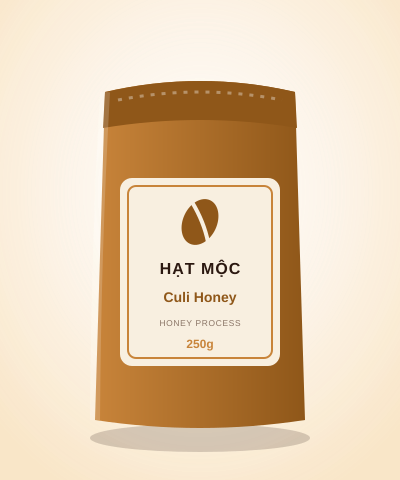

# function_logic.md

**Họ và tên:** Cao Quốc Cường
**Dự án:** Hạt Mộc Coffee - Website cà phê đặc sản Việt Nam
**Thử thách:** Dùng JavaScript và vòng lặp để tự sinh giao diện danh sách sản phẩm từ dữ liệu mẫu, thay cho việc viết HTML từng sản phẩm.

---

## 1. Ý tưởng chung

Trước đây trang có 6 khối `<li><article class="card">...</article></li>` viết tay, mỗi khối dài khoảng 15 dòng và chỉ khác nhau ở tên, giá, ảnh. Bây giờ phần HTML chỉ còn **một vùng chứa rỗng**:

```html
<ul class="product-grid" id="product-grid"></ul>
```

Toàn bộ thẻ sản phẩm được file `script.js` tự sinh ra từ một **mảng dữ liệu**. Muốn thêm, sửa hay xóa sản phẩm, chỉ cần sửa mảng, không đụng đến HTML.

```text
Mảng products  ──truyền vào──▶  renderProducts(list, container)  ──vòng lặp──▶  các thẻ <li> trong #product-grid
 (dữ liệu)                          (hàm xử lý)                                      (giao diện)
```

---

## 2. Dữ liệu đầu vào: mảng `products`

Mỗi sản phẩm là một **object** với các thuộc tính cố định, cả mảng gồm 6 object:

```js
const products = [
  {
    id: 1,
    name: 'Arabica Cầu Đất',                         // tên hiển thị ở thẻ <h3>
    notes: 'Hương hoa, chua thanh, hậu vị caramel',  // mô tả ngắn
    price: 185000,                                   // kiểu SỐ, không phải chuỗi
    weight: '250g',                                  // quy cách
    image: 'assets/product-1.svg',                   // đường dẫn ảnh
    alt: 'Gói cà phê Arabica Cầu Đất 250g',          // mô tả ảnh cho trình đọc màn hình
    category: 'rang-xay',                            // dùng cho bộ lọc
    tag: { text: 'Bán chạy', type: 'hot' }           // nhãn góc ảnh (có thể bỏ)
  },
  // ... 5 sản phẩm còn lại
];
```

| Thuộc tính | Kiểu | Hiển thị ở đâu |
|---|---|---|
| `name` | chuỗi | Tiêu đề `<h3>` của thẻ, và `<option>` trong form liên hệ |
| `notes` | chuỗi | Dòng mô tả `<p class="notes">` |
| `price` | số | Giá, được định dạng thành `185.000đ` bằng `formatPrice()` |
| `weight` | chuỗi | Nhãn quy cách bên phải giá |
| `image`, `alt` | chuỗi | Thuộc tính `src` và `alt` của `` |
| `category` | chuỗi | Quyết định sản phẩm xuất hiện khi lọc danh mục nào |
| `tag` | object | Nhãn nổi trên ảnh: `text` là chữ, `type` là `hot`, `new` hoặc `default` (chọn màu) |

---

## 3. Cách truyền dữ liệu vào hàm

Hàm chính có **hai tham số**:

```js
function renderProducts(list, container) { ... }
```

- `list`: **mảng** các object sản phẩm cần hiển thị (dữ liệu truyền vào).
- `container`: **phần tử HTML** sẽ chứa kết quả (nơi hiển thị), ở đây là `<ul id="product-grid">`.
- Giá trị trả về: số sản phẩm đã hiển thị.

Cách gọi:

```js
const grid = document.getElementById('product-grid'); // lấy vùng chứa
renderProducts(products, grid);                       // truyền mảng + vùng chứa vào hàm
```

Tách `list` và `container` thành hai tham số giúp **một hàm dùng được cho nhiều tình huống**: hiển thị cả 6 sản phẩm, hoặc chỉ một phần của mảng sau khi lọc, mà không phải sửa hàm.

---

## 4. Bên trong hàm: vòng lặp biến dữ liệu thành giao diện

```js
function renderProducts(list, container) {
  if (!container) return 0;                       // không có chỗ hiển thị thì dừng

  if (!Array.isArray(list) || list.length === 0) { // danh sách rỗng
    container.innerHTML = '<li class="empty-state">Chưa có sản phẩm nào trong danh mục này.</li>';
    return 0;
  }

  let html = '';
  for (let i = 0; i < list.length; i++) {         // duyệt từng sản phẩm
    html += createProductCard(list[i], i);        // mỗi lần lặp sinh một thẻ <li>
  }
  container.innerHTML = html;                     // gắn tất cả vào trang một lần
  return list.length;
}
```

Các bước diễn ra:

1. **Kiểm tra đầu vào**: không có `container` thì dừng. Mảng rỗng hoặc không phải mảng thì hiện thông báo "Chưa có sản phẩm".
2. **Vòng lặp `for`**: biến `i` chạy từ 0 đến `list.length - 1`. Ở lượt thứ `i`, `list[i]` là object của sản phẩm thứ `i`.
3. **Sinh thẻ**: mỗi lượt gọi `createProductCard(list[i], i)`. Hàm này nhận **một object sản phẩm** và trả về chuỗi HTML của một thẻ `<li>`. Các giá trị được chèn vào chuỗi bằng template literal:

   ```js
   `<h3>${escapeHTML(product.name)}</h3>
    <p class="notes">${escapeHTML(product.notes)}</p>
    <span class="price">${formatPrice(product.price)}</span>`
   ```

   Dấu `${...}` lấy giá trị từ object, ví dụ `product.name` thành `Arabica Cầu Đất`.
4. **Nối chuỗi**: `html += ...` gom 6 thẻ thành một chuỗi dài.
5. **Hiển thị**: `container.innerHTML = html` đưa toàn bộ vào trang, trình duyệt vẽ ra 6 thẻ sản phẩm.

### Hai hàm phụ trợ

- `formatPrice(185000)` trả về `"185.000đ"` (dùng `Intl.NumberFormat('vi-VN')`), nên trong dữ liệu `price` luôn là số.
- `escapeHTML(text)` đổi các ký tự `< > & " '` thành mã an toàn, để dữ liệu có ký tự đặc biệt không làm vỡ giao diện.

---

## 5. Ví dụ chạy từng bước với một sản phẩm

Dữ liệu vào (`list[0]`):

```js
{ name: 'Culi Honey', price: 195000, weight: '250g', tag: { text: 'Mới', type: 'new' }, ... }
```

Chuỗi HTML hàm tạo ra (rút gọn):

```html
<li data-aos="zoom-in-up" data-aos-delay="0">
  <article class="card">
    <figure class="card-media">
      
      <span class="tag tag-new">Mới</span>
    </figure>
    <section class="card-body">
      <h3>Culi Honey</h3>
      <p class="price-row"><span class="price">195.000đ</span><span class="weight">250g</span></p>
      <a href="#lienhe" class="btn btn-small" data-product="Culi Honey">Đặt mua</a>
    </section>
  </article>
</li>
```

Cấu trúc thẻ này giống hệt khối HTML viết tay trước đây (giữ nguyên `<article>`, `<figure>`, `<section>`, không dùng `<div>`), nên CSS cũ vẫn áp dụng bình thường.

---

## 6. Dùng lại cùng một hàm cho bộ lọc

Vì hàm nhận mảng làm tham số, bộ lọc chỉ cần **truyền vào một mảng khác**:

```js
function filterProducts(list, categoryId) {
  if (categoryId === 'all') return list;
  return list.filter(function (p) { return p.category === categoryId; });
}

const visible = filterProducts(products, 'pha-san'); // mảng mới chỉ có 2 sản phẩm
renderProducts(visible, grid);                       // hàm renderProducts giữ nguyên, không sửa
```

Khi bấm nút "Pha sẵn & tiện lợi", mảng `visible` chỉ còn Cold Brew Chai và Phin giấy Drip Bag, hàm hiển thị đúng 2 thẻ và bộ đếm ghi "Đang hiển thị 2/6 sản phẩm".

Cùng một nguồn dữ liệu còn được dùng cho:

- **Thanh nút lọc**: `renderFilterButtons()` cũng dùng vòng lặp để tạo nút từ mảng `CATEGORIES`.
- **Danh sách chọn sản phẩm trong form liên hệ**: `renderProductOptions()` tạo các `<option>` từ chính mảng `products`.
- **Nút "Đặt mua"**: mang thuộc tính `data-product`, khi bấm sẽ chọn sẵn sản phẩm đó trong form.

---

## 7. Cách thêm sản phẩm mới

Chỉ cần thêm một object vào cuối mảng `products` trong `script.js`:

```js
{
  id: 7,
  name: 'Espresso Blend',
  notes: 'Đậm, ngọt hậu, nhiều crema',
  price: 210000,
  weight: '250g',
  image: 'assets/product-1.svg',
  alt: 'Gói cà phê Espresso Blend 250g',
  category: 'rang-xay',
  tag: { text: 'Mới', type: 'new' }
}
```

Tải lại trang, thẻ thứ 7 tự xuất hiện, bộ đếm và số trên nút lọc tự cập nhật, form liên hệ có thêm lựa chọn mới. Không cần sửa `index.html`.

---

## 8. Tổng kết

| | Trước | Sau |
|---|---|---|
| Thêm 1 sản phẩm | Copy, dán ~15 dòng HTML rồi sửa tay từng chỗ | Thêm 1 object vào mảng |
| Số dòng HTML phần sản phẩm | ~90 dòng lặp lại | 1 thẻ `<ul>` rỗng |
| Sửa giá, tên | Tìm trong HTML, dễ quên chỗ trong form | Sửa 1 chỗ duy nhất trong dữ liệu |
| Lọc theo danh mục | Không có | Có, dùng lại chính hàm `renderProducts` |

Cách truyền dữ liệu cốt lõi: **mảng object → tham số `list` → vòng lặp `for` duyệt từng object → template literal chèn giá trị vào HTML → gắn vào `container`**.
